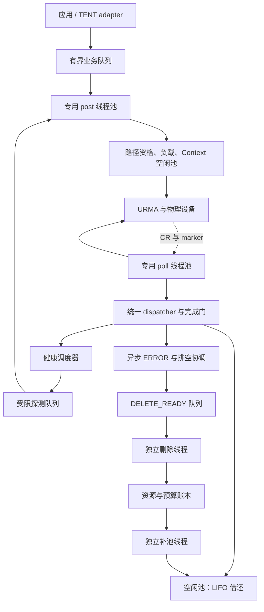
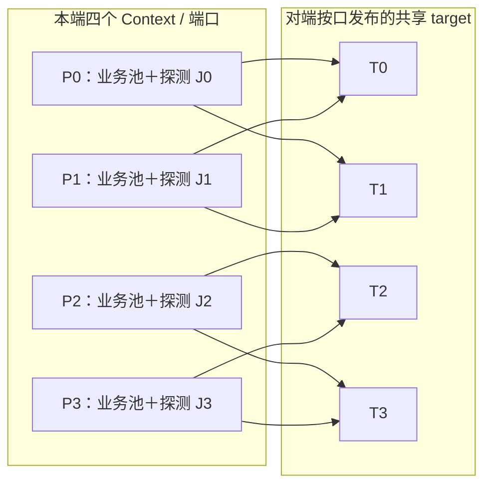
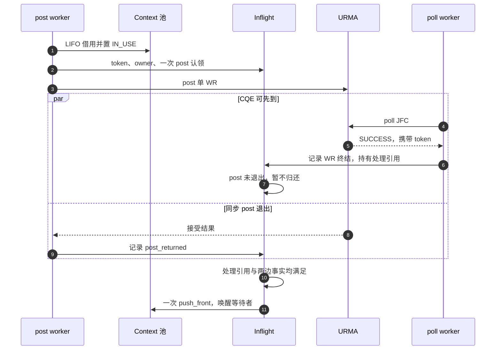
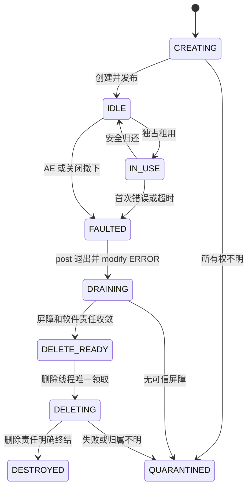
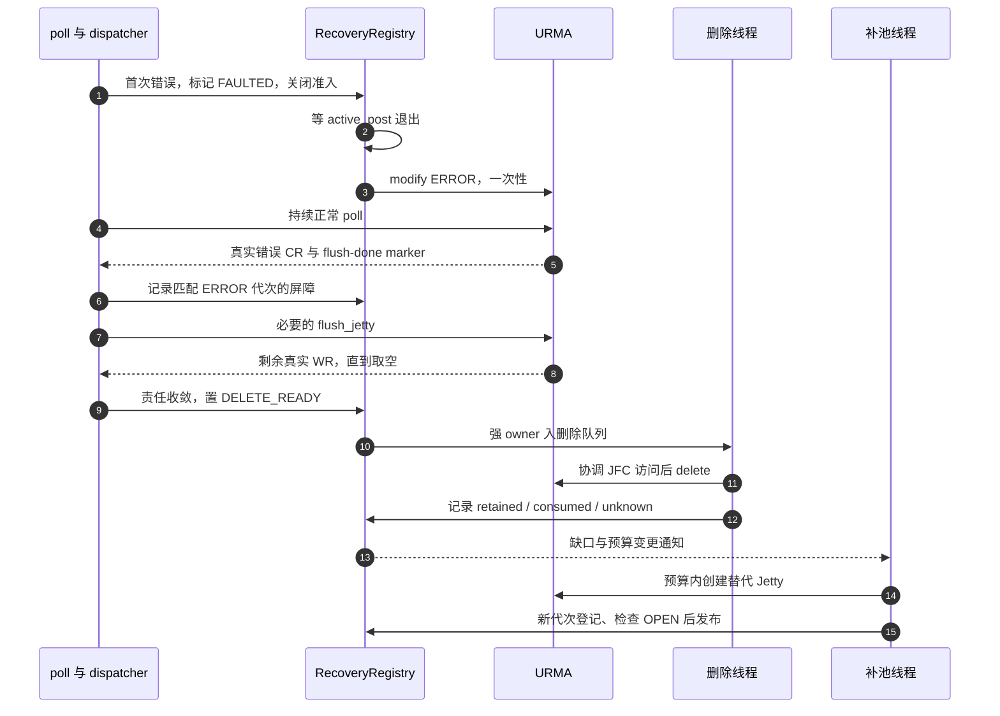
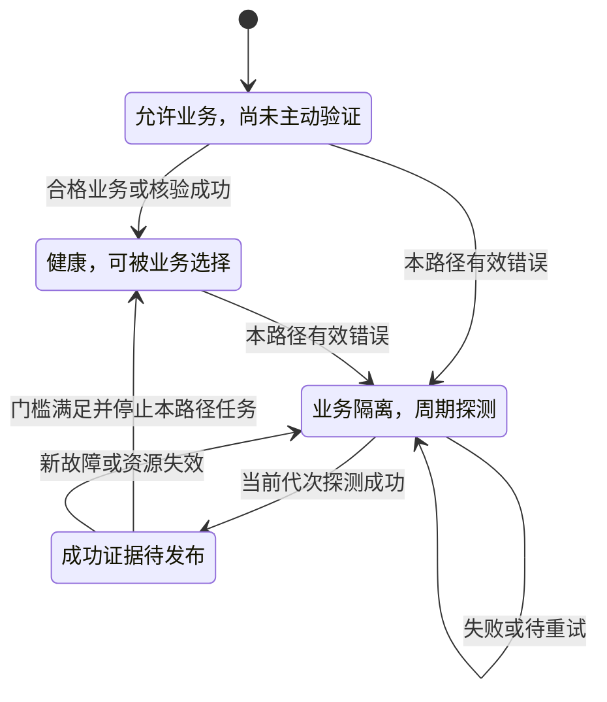
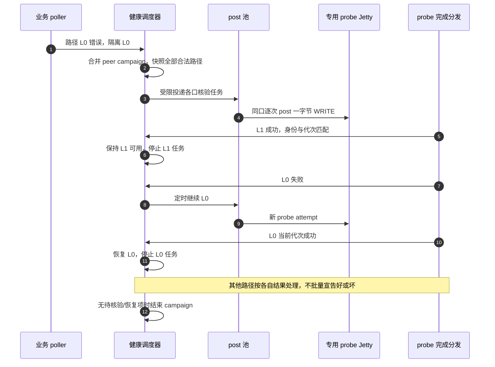
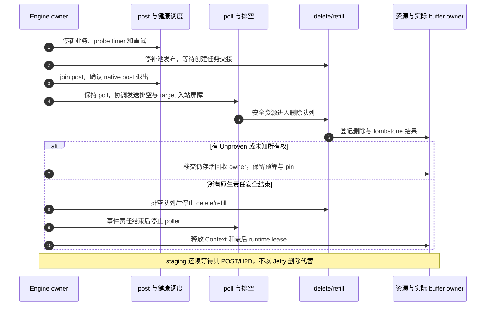

# TENT 物理 UB RM Jetty 池化与线程池管理详细设计 V4

> 日期：2026-11-11。状态：待实现、可评审的 V4 设计；不表示代码已支持 pooled RM，也不表示 provider 或实机验收已通过。
>
> 当前代码基线：Mooncake `mainhc / 48aa86c1c27987b221abc4313fb1dad98f2ae519`。本轮 UB 变化基线：`956af65e9b094e8adc8b4b9ec9b3105824b6e296`；提交原子性修复：`5e3999588936e48dd969084e9c9f89666aae676f`。
>
> V3 来源：[Supercache 29db96ff 的 V3 设计](https://github.com/HangCong126/Supercache/blob/29db96ffceed1493fa81ec5ab2d8b426cd995449/docs/analyze/tent-ub-rm-jetty-pool-design.md)，其代码基线为 `822d7d83716269a186198997b95ad349ed377324`。V4 保留 V3 的池化、单 WR、共享 target、探测与 DMA 安全约束，并完整补充当前提交契约。
>
> UMDK 参考基线：`09086da5d86c53f83eb395109d636957d3efcc79`。引用为参考源码事实；没有对应目标硬件、驱动、profile 与测试记录时，不称为实机结论。
>
> 范围：非 bonding 物理 UB、URMA RM、CPU DRAM 单边 READ/WRITE；设备内存 staging 由 TENT runtime 管理。本文新增一个本地设计文件，不更改代码、不发布 SDK、不变更文档站点导航。

## 0. V4 变更、优先级与交付边界

V4 是本地当前代码基线的完整设计，不要求读者自行拼接旧文档。V3 中与本版冲突的提交、接口和分工描述以本版为准；其他仓库的文档和开发者实现不会因本文发布而自动完成接口冻结。

| 内容 | V4 决定 |
| --- | --- |
| 保留核心模型 | 每 attempt 独立选路、单 WR、Context 池独占租用、LIFO、共享 target、专用 probe 发送资源、异步 drain/delete/refill |
| 整批提交 | 原子范围为一次 request_list 的全部 Task；容量先预留，Task 不能部分发布 |
| 容量责任 | admission reservation 覆盖构造、queued、posting、parked、inflight、retry，直到最终安全结算 |
| 失败与重试 | 背压不改 Task；标记后的失败保留当前终止性处理；native 接受状态与请求执行结果分层 |
| 发布与通知 | 保留 progress_armed 等价屏障、SubBatch 可查询性以及 arming 后补通知 |
| 两人分工 | A 负责原生资源与恢复机械；B 负责 post/poll、健康及 TENT/Store/staging 接入；共享接口先于并行实现冻结 |
| probe 投递 | 仍经公共 post 池的受限控制队列，不采用专用线程绕过统一 ticket |
| 尚待验证 | provider 接受状态、入站屏障、delete 失败语义、物理身份、进程终止清理、容量与性能阈值 |

第 18 节固定新增提交语义；第 19 节固定两人分工与跨侧协议；第 20 节区分已定规则和外部验证项；第 21 节规定实施依赖；第 22 节列验收矩阵。文中类型/方法名为目标接口，不得解释为当前已存在。

## 1. 已确认约束与实现边界

| 项目 | 本版决定 |
| --- | --- |
| 选路 | 每个 slice attempt 独立选择本地 Context/EID＋远端按口 target，不按 Group/Task 汇聚 Jetty |
| 发送池 | 每个 Context 建池；先选路，再从对应池租用一个空闲发送 Jetty |
| WR | 每 attempt 最多一次 native post，输入恰好一条 WR；重试是新 attempt |
| 独占 | 一个业务发送 Jetty 同时只服务一个 attempt；正常归还后可顺序访问其他 peer |
| 空闲顺序 | 同池 LIFO，刚归还的成员优先下次使用；不改变路径选择顺序 |
| 远端目标 | 节点每个配置端口发布一个共享 target，业务与探测共同使用；endpoint 只引用 |
| 探测资源 | 每个本地端口一个专用 RM 发送 Jetty，不进入业务发送池 |
| 拓扑 | 从端口清单和合法邻接关系计算路径；每口两个邻居时，4 口为 8 路、6 口为 12 路 |
| 探测启动 | 业务错误立即隔离出错路径，同时对该 peer 的配置路径集合发起受限核验 |
| 探测停止 | 某条路径取得当前有效成功证据并恢复后，停止该路径的周期任务 |
| 错误 Jetty | 首次真实错误 CQE 对应的发送 Jetty 强制退役，不因后续探测成功回到业务池 |
| 排空 | 关闭 post 门禁，modify ERROR，持续 poll，识别 flush-done，再结算剩余 WR |
| 删除 | 独立删除线程消费 DELETE_READY 队列，不能在 poll 热路径直接销毁 |
| 补池 | 独立补池线程扫描并响应缺口事件；恢复静态目标容量，不无限扩池 |
| 线程 | 专用 post 池和 poll 池；探测也交 post 池，应用不直接 native post/poll |
| 请求限额 | K 约束单个网络 UbTask 跨 Context 的准入 attempt，不是父 staging 请求窗口 |
| 可靠性 | timeout/cancel 不等于 DMA 结束；保留实际 buffer owner、quarantine 和事件归属 |

不引入 Group、window、producer Seal、RC 池化、原生业务 SEND/RECV/atomic、跨 Jetty 的全局写顺序或请求原子可见性。`UbTask::seal` 仅封闭 slice 集合，不能代替 post 退出或 DMA 屏障。

## 2. 当前代码与 UMDK 参考的适用范围

本节当前代码事实以 `mainhc / 48aa86c1c27987b221abc4313fb1dad98f2ae519` 为准。相对此前核对的 `956af65e`，原生 UB 的 25 个生产文件中只有 `workers.h`、`workers.cpp`、`ub_transport.cpp` 改变，均来自 `5e399958` 的整批提交修复。`submitBatch` 是一次 API 调用的原子队列发布，不是多 WR 链；发送仍逐 slice 选路并执行 `post(jetty, {work}, posted_count)`。

| 当前新增事实 | V4 接入要求 |
| --- | --- |
| 一次 request_list 的全部 Task 经 submitBatch 一起发布 | 整批预留容量，禁止逐 Task 发布后因后续拒绝而回滚已发送前缀 |
| 入队异常会撤销本次插入项并取消已标记的私有 Task | 区分容量背压与终止性提交失败，不能承诺任何失败均可重试原 Task |
| progress_armed 在 SubBatch 发布后开启，并主动补一次通知 | callback 执行器不得破坏可查询性和完成通知之间的发布屏障 |
| runtime 分开配对 logical request 与 transport attempt 观测 | UB slice attempt 计数另行维护，不能重复记用户请求或用指标代替资源账本 |
| SegmentTracker 批量合并相同地址、长度的注册 | Region 引用数、最后一次注销和 backing owner 分开处理 |

`4f6a9840` 的切片准备流水线只改变 RDMA，不改变原生 UB。MLU/XPU DMA-BUF 直连 RDMA 不扩大本方案的 CPU DRAM 范围。以下已有事实仍适用：

| 已有事实 | 本版设计如何使用 |
| --- | --- |
| TENT 原生 UB 已有 post/poll 两组线程、逐 slice 路由和单条 WR 提交 | 复用框架，新增 Context 发送池与租用完成门 |
| 当前 TENT Jetty/导入仍按 RC 建立 | 必须新增明确 RM profile，不能仅改变数量参数 |
| TENT Adapter 已区分实体 marker，quiesce 会等待 flush-done 并调用 flush_jetty | 改为异步状态推进，由正常 poller 和统一 dispatcher 完成 |
| UMDK health 每本地资源使用独立 RM 探测 Jetty | 保留业务与探测发送资源隔离 |
| UMDK 按 connected 矩阵导入可达 target | 使用动态邻接表，不照搬固定四口数组 |
| UMDK 探测为专用注册区的一字节 WRITE | 采用相同操作类型；不写业务内存，不宣称验证了远端数据内容 |
| UMDK 在创建 Jetty 时启动周期探测 | 本版改为业务错误触发，恢复后停止对应路径任务 |

UMDK health 所在位置是 bonding provider。这里只参考其探测资源、WR 和拓扑组织；物理模式不调用 BONDP 控制接口、不依赖 bonding provider，也不直接照搬其同步重建及 poll 数量扣计数方法。

## 3. 资源模型与组件边界

### 3.1 原生资源的唯一 owner

| 对象，均为目标设计名 | 归属与责任 |
| --- | --- |
| PortBinding | 配置 port_id 到 device、EID/index、Context 的准确映射 |
| UbContextResource | Context、JFC/JFR profile、业务池和设备预算 |
| SendJettyPool | IDLE 栈、租用状态和容量账本；不持锁调用 provider |
| RmSendJetty | 唯一 native owner、generation、PostGate 和退役状态 |
| SliceJettyLease | 一个业务 attempt 对一个发送成员的独占使用权 |
| LocalPortTarget | 每端口一个本地共享 target，发布给多个 peer；拥有 target 原生依赖 |
| PeerTargetDescriptor | peer 按口发布的 target、EID/UASID、profile 和 target_epoch |
| ImportedTargetRegistry | 按本地 Context 导入远端 target；多个 endpoint、业务和探测可引用 |
| UbEndpoint | 路径视图、目标和注册引用，不拥有或直接销毁共享 target |
| ProbeResource | 每本地端口一个专用发送 Jetty、探测源内存和独立额度 |
| PathRegistry / PathHealth | 合法路径及各自业务资格、fault_epoch、探测结果 |
| PeerProbeCampaign | peer 的一次核验轮次、待核验路径与周期任务去重 |
| Inflight / TransferLifetimeOwner | token、post/WR 责任、lease、额度、Task/batch 与实际 buffer pin |
| BatchAdmissionReservation | 一次 request_list 的总 slice、Task/通知容量预留，覆盖构造、排队、post、defer 与 retry |
| SubmitPublication | 私有 Task、SubBatch 可查询性、通知 arming 和补充唤醒的一次性发布责任 |
| PathLoadLedger | 按稳定 PathVersion/TargetKey 维护发送负载，提供 registry 只读快照，不重复计数 |
| RecoveryRegistry | 排空、DELETE_READY、quarantine、tombstone 和删除任务 |

发送 Jetty 不因服务不同 endpoint 而重复创建。target 数量也不再随 endpoint 数增长；但导入句柄仍按本地 Context 和远端 target 展开。

### 3.2 身份与代次

```text
ContextKey = device_identity + EID + context_incarnation
LocalTargetKey = node_incarnation + port_id + target_epoch + profile
ImportedTargetKey = local ContextKey + peer LocalTargetKey + native EID/UASID/ID
PathKey = local ContextKey + peer_incarnation + remote_port_id + profile
PathVersion = PathKey + topology_epoch + target_epoch
LaneKey = ContextKey + native Jetty ID + lane_generation
AttemptKey = task_id + slice_id + attempt_generation
ProbeKey = PathVersion + fault_epoch + campaign_id + probe_sequence
```

CompletionToken 在进程内唯一，映射到业务 attempt 或 probe；不直接复用地址。eid_index 不是端口号，native ID 不是全局身份。没有代次的原生事件不能靠软件 generation 自动消除 ABA。

### 3.3 图一：组件、线程与队列



箭头表达运行关系，不表达链接依赖。组件化仍采用 ub_core 定义窄接口、ub_transfer 读取健康资格、ub_health 经 post 队列发探测，由 UbEngine 装配；TENT adapter 不复制第二套数据面。

## 4. 配置拓扑：4 口 8 路与 6 口 12 路

### 4.1 数量与含义

定义本地端口集 L，远端 target 端口集 R，合法邻接集合 E：

```text
E = {(local_port, remote_port) | 配置允许且双方资源身份校验通过}
link_count(A→B) = |E| = Σ degree(local_port)

每本端口恰好两个合法远端邻居时：
N 个本端口 → N 个本地探测 Jetty、2N 个导入关系、2N 条有向路径
```

对称部署下，远端发布 N 个原生 target，并非 2N 个。A→B 与 B→A 分别建表；8 条不是来回合计，不是 8 根物理线缆，也不保证底层物理路由完全独立。

| 部署条件 | 远端原生 target | 本地探测发送 Jetty | 本方向导入关系 / 路径 |
| --- | --- | --- | --- |
| 双方 4 口，每本端口两个邻居 | 4 | 4 | 8 |
| 双方 6 口，每本端口两个邻居 | 6 | 6 | 12 |
| 双方端口数不等或邻接不规则 | 远端已验证端口数 | 本地端口数 | 实际合法邻接总数 |

import 的作用域是本地 Context，不是探测 Jetty 绑定两个 target。业务和探测在 WR 中逐次指定 imported tjetty，RM 不做 RC bind。

### 4.2 图二：四口共享目标示例

下图仅演示合法邻接配置，不声称任意物理部署都具备这些连接；实际按配置模板与发现结果校验。



### 4.3 配置草案与启动校验

以下是待实现的 topology 子配置示例；device/EID 为占位值，不可直接运行：

```json
{
  "port_count": 4,
  "ports": [
    {"id": "P0", "device": "<device0>", "eid": "<eid0>", "eid_index": 0},
    {"id": "P1", "device": "<device1>", "eid": "<eid1>", "eid_index": 0},
    {"id": "P2", "device": "<device2>", "eid": "<eid2>", "eid_index": 0},
    {"id": "P3", "device": "<device3>", "eid": "<eid3>", "eid_index": 0}
  ],
  "peers": [{
    "id": "<peer-id>",
    "adjacency": {
      "P0": ["R0", "R1"],
      "P1": ["R0", "R1"],
      "P2": ["R2", "R3"],
      "P3": ["R2", "R3"]
    }
  }]
}
```

port_count 校验 ports 长度，不用于猜测远端端口编号。若使用自动拓扑模板，模板必须明确可达关系，展开结果与显式邻接表走同一验证链。6 口部署更新 ports 与模板/邻接即可，代码不出现固定 4、8 或定宽四口掩码。

启动核验：ID 唯一、每邻居有效且去重、数量和上限无溢出；配置端口与发现设备/EID匹配；对端公布完整 inventory、target epoch 和权限；导入 profile 兼容。失败项为 INVALID/UNAVAILABLE，不能伪造 Healthy。

一个 primary EID 可能覆盖多个物理端口。若部署不能把配置口与所需路径事实准确关联，应拒绝相应物理口隔离能力；不能把多个配置别名指向同一资源后宣称独立四口。首版启动时固化拓扑，运行中变更需要新 topology_epoch、撤销旧准入并排空，不原地改写旧 PathKey。

## 5. 节点共享 target 的发布、导入与退役

首版每端口使用一个双方验证兼容的 RM profile；不在“四口四 target”的数量结论中暗含多个 profile 的额外目标。若未来每口需多个不同 profile，必须相应扩展发布协议和数量预算。

1. 节点按每个 PortBinding 创建一个 LocalPortTarget，配置关联的 JFR/JFC、RM profile 和授权。
2. 发布节点 incarnation、端口清单、EID/UASID/ID、target_epoch、注册描述 ABI 与能力。
3. 本地按邻接关系在相应 Context 导入；ImportedTargetRegistry 唯一持有 native import。
4. endpoint 和 ProbeResource 持引用，WR 带对应 target；endpoint 淘汰只释放引用，不直接 unimport 共享句柄。
5. 本地发送成员顺序跨 peer 复用不触发 target 重建；共享 target 故障则隔离所有引用它的路径。
6. target 重建发布新 epoch，所有 peer 更新相关导入；旧导入保留到其在途责任结束。

共享故障域明确扩大：同一目标被多个业务 endpoint、探测和 peer 使用。LocalPortTarget ERROR 不能按一个发送 lease 的流程就地删除；必须撤销发布、停止相关 peer 新 WR，并取得 provider 定义的入站屏障。peer 停发 ACK 或超时都不能替代入站 DMA fence；MR 注销覆盖所有授权 target/peer。

探测仍使用独立注册区。多个 peer 可使用分配给各自的探测槽位或经验证的无业务语义探测区，禁止写入业务地址。WRITE 探测成功只证明当前探测配置的可用性，不证明所有业务 READ/WRITE 权限。

## 6. 物理 RM 阶段零与协议门槛

| 门槛 | 必须满足 |
| --- | --- |
| 物理构建 | 不强制依赖 urma_ubagg.h，物理模式不调用 BONDP，不使用私有 WR 扩展 |
| RM 原生能力 | 标准 urma_jfs_wr_t，逐 WR tjetty，同发送成员顺序跨 peer |
| 共享 target | 多发送 Jetty、多 peer、业务与探测并发访问均验证 |
| 身份 | 完整 EID/UASID、Context/节点/target 代次和 profile；不丢弃非零 UASID，零是否合法按 provider 契约 |
| 注册 | 实际返回范围覆盖请求；超限明确拒绝或显式 MR 分段，不静默截短 |
| ABI | raw segment 编码长度、schema、ABI、访问权限、范围与溢出逐项校验 |
| 排空与事件 | modify ERROR、send JFC flush-done、flush_jetty、AE ACK 和 delete 语义明确 |
| 并发 | poll 与 delete/clean_jfc、import/unimport 的并发契约可验证 |
| 健康事实 | 物理端口归属明确；能力缺失不伪造 GOOD/BAD，不调用 BONDP 四口查询 |
| 资源 | 发送、探测、共享 target、JFC/JFR/MR 与替换余量均可分配 |

独立 Engine 默认 RM_ONLY，不透明切 RC。TENT 显式 legacy RC 仅可在逻辑请求尚无任何可能接受 WR 时选择，资源、协议和验收分开；不进入本池，不跨 peer 重绑。

## 7. post 调度：路径负载与 LIFO 租用

### 7.1 两级选择

```text
slice attempt
  → 排除 INVALID / 故障路径及无效 target/Region
  → 依据拓扑等级、在途负载、带宽反馈、quota 选择路径
  → 确定本地 Context 与远端 imported target
  → 从所选 Context 的 IDLE 栈取最近归还的 Jetty
  → 安装 Inflight 与门禁票据，post 唯一 WR
```

沿用当前路径评分的分层结构，不以“刚归还”覆盖负载均衡，不以池空闲数伪装物理带宽。队列等待、quota 等待和 staging 时间不进入网络带宽样本。路径共享端口时同时计 device/Context 负载，避免把两个邻接关系误当两倍独立带宽。

评分采用当前 UbPathSelectionScore 的分层比较起点：可准入优先，其次拓扑等级、归一化在途字节/WR、相关目标的本进程在途压力、有效带宽样本，最后按 retry_order 与稳定设备 ID 打破平局。资源预留后再复核，防止多个 post worker 根据过时的空闲快照同时过量准入。

共享 target 后，原 endpoint_outstanding 不再是目标总压力。V4 由线程池侧唯一维护 PathLoadLedger：按稳定 PathVersion 统计路径负载，按 TargetKey 聚合本进程对同一远端 target 的 WR/字节；PathRegistry/ImportedTargetRegistry 提供身份与只读查询，不再另写一份负载账本。资源准入后、native post 前计入预留压力，确定未接受时回滚，安全终结时一次性扣减；endpoint 视图切换不能将负载清零。业务与 probe 分账，probe 不能形成业务带宽样本；远端其他进程/peer 的未知压力不伪装成已知。

候选排序阶段不为全部组合发握手 RPC；优先使用已就绪 target 描述，并按本地设备分散、限额准备冷路径。缺失目标由控制执行器异步握手/导入，post worker 延后该候选，不能持 lease 等待网络控制调用。

路径没有空闲成员时，可尝试同策略允许的其他合格路径；不反复选空池忙等，不把容量不足当路径故障，也不创建临时 Jetty 绕过预算。

### 7.2 原子准入与回滚

1. 准备已验证 endpoint、imported target 与 Region。
2. 非阻塞取得网络 UbTask 的 K permit 和 device/path quota。
3. 在 Context 的统一 LIFO 栈中，优先选择最近归还且其 JFC 尚有 credit 的成员；非阻塞预留该 JFC credit，再原子弹出 IDLE、改为 IN_USE，绑定本 attempt。竞争失败时释放预留并重选。
4. 保留 target/Region 引用和实际 buffer owner，发布唯一 completion token。
5. 在有序 gate 协议中复核 stopping、PathVersion、fault_epoch、target 和注册代次，再认领一次 post。
6. 任何确定未 post 的失败逆序回滚；不得持部分资源阻塞等待其他资源。

pool mutex 只保护 IDLE 栈、成员状态和计数；credit 只执行非阻塞原子预留，不在锁内等待。provider/RPC 不在该锁内执行。使用互斥锁栈作为首版实现，避免无证据的无锁栈 ABA。归还 push_front、租用优先取栈首；新建成员放栈尾。多个 JFC 不各自无条件分流而破坏 Context 的最近归还优先；优先级只在本轮可准入成员集合内成立。

### 7.3 K、切片与典型读写

当前 UB 默认 slice_size=64 KiB，max_slices_per_task=65536，参数为 transports/ub/*；MC_SLICE_SIZE 当前只兼容映射 TENT RDMA，不控制原生 UB。这里不引入 TENT RDMA 的 32/64 片自适应规划。

例如 1 MiB DRAM READ 默认为 16 个 slice，K=4 时最多准入 4 个业务 attempt。每个 attempt 独立选路、借一个 Jetty，成功安全结算后归还并推进后续分片。WRITE 使用相同调度，但非 inline 源保持不变；READ 目的在成功完成前无效。

K 不是总片数、Jetty 池大小或父 Store GET/PUT 的上限。若 runtime 同时产生 C 个 CROSS 子 Task，父请求可能贡献 C×K 个准入 attempt，仍受实际池和设备额度限制；首版不引入 Group/窗口。

### 7.4 共享门禁、attempt 状态与 post ticket

业务和 probe 均使用共享准入门禁。PathHealth 的隔离/fault_epoch 递增与 PathAdmissionGate 关闭使用同一同步协议；Lane PostGate、target/Context 撤销与 post ticket 认领也须有明确线性化顺序。仅传递 fault_epoch 快照，或先检查句柄 generation 后直接 post，都不能防止检查后发生的隔离/删除。

池化侧提供 gate/ticket 原语，线程池侧健康模块同步关闭路径 gate 后再异步调度后续工作。beginErrorOnce 必须先以短 CAS/临界区撤销成员可用性，再将 modify/排空任务登记到有界恢复队列。不能只入队而让错误成员继续可租用。已认领 ticket 计入 active_post，post 返回或确定不调用 native post 后退出；关闭不作废已认领 ticket，ERROR/删除等待其退出。所有门禁锁按固定稳定顺序取得，锁内不调用 provider。

明确区分以下状态入口，均是待实现契约，不是当前 slice.h 已支持的 API：

| 位置 | 处理 |
| --- | --- |
| beginAttempt 前 K/quota/lease 不足 | 保持排队资格，登记 defer，不消费 retry |
| beginAttempt 后、确定未调用 native post，gate 关闭 | 使用 rollbackUnposted 等价转换回可排队状态，不消费 retry；保留旧 attempt 识别以忽略迟到软件事件 |
| ticket 已认领、取消在 native post 前获胜 | 撤销未使用 ticket，安全回滚；不得遗留 active_post |
| native post 返回 NotAccepted | 用匹配的 attempt token 结算；仅可重试错误且预算允许时生成新 attempt |
| Accepted 或 Unknown | 不走未提交回滚；持有责任直到真实完成或可信排空证明 |

当前 resolveBeforePost 明确拒绝 kPosting/kPosted；native post 返回后不能调用它替代 resolveAttempt。新增无 retry 回滚必须与取消竞争、attempt 代次匹配共同实现，不得用 requestCancellation 伪装容量延期。完成后能否重试还受第 17 节执行结果契约限制。

### 7.5 defer、取消与截止时间

defer 以等待的实际资源为键分桶，例如 TaskId 的 K、Context/池、JfcKey 的 credit、PathVersion 的健康、TargetKey 的准备状态。先读 epoch，再判断资源，登记后复核；若 epoch 已变则不睡眠，避免失败判断与登记之间丢唤醒。

普通归还、quota/credit/K 释放、补池、target 准备完成、Context 重建、路径恢复都更新对应权威状态并触发相应桶。通知队列只负责唤醒，registry 中的待办/脏位为权威，不能因队列满丢掉状态。post worker 的等待谓词同时包含队列非空、可回流脏桶、取消和 stopping。

排队、构造中已准入项、parked 项及在途 record 均受请求总 deadline 约束；不能只扫描已有 WR record。未 post 的取消/过期项及时摘除并结算、退还 admission reservation；在途取消/过期仅结束逻辑等待，保留 DMA 责任。无业务且资源长期不恢复时，也必须能推进取消、截止和关闭。

## 8. 正常完成门与归还竞争

Inflight 至少记录 post_claimed、post_returned、acceptance、wr_terminal、handler_refs、fault_seen、finalize_claimed、lease_return_claimed 及所有 owner/credit。

```text
正常成功归还 =
  post_returned
  AND acceptance == Accepted
  AND 当前唯一真实 WR CQE == SUCCESS
  AND 完成处理不再访问本次可复用状态
  AND 未见故障/退役要求、pool OPEN
  AND 一次性归还认领成功
```

确定零接受且成员未故障时可以回滚后归还；接受 Unknown 则保留可能责任并走排空。真实错误 CQE 不走正常归还。真实 WR CQE 可证明被接受，若 post 同时报告确定零接受，按契约冲突隔离。

先在 registry 安装 token，再 native post；post 调用栈强持有 Inflight。post 返回和 CQE 处理都推进同一完成门。归还与 FAULTED 转移共享状态同步，不能先入 IDLE 栈、再异步决定它出错。

完成门由线程池侧推进，池侧 release 在同一成员同步域中最终复核 FAULTED/retire、pool OPEN 和代次，可拒绝回池并接管退役。错误/超时成员不走正常成功归还；其 record 在硬件责任结束、post/ticket 退出、相关 handler 不再访问后，通过 finalize 一次性释放 K、WR quota、引用和实际 pin。native 预算另等实际销毁，不随 finalize 释放。probe record 同样必须等待 post_returned 与 handler 退出，单一调度者不能替代这个条件。

### 图三：CQE 先于 post 返回



pool 对成员的复用必须晚于旧 attempt 对成员可变状态的最后访问，不能只靠 shared_ptr 保住内存就认为没有新旧 attempt 的逻辑竞争。

## 9. 错误 Jetty 的异步退役

### 9.1 图四：业务发送成员状态机



DELETED 不是“回池”，补建得到新 native 对象和新 generation。路径恢复不使 FAULTED/DRAINING 成员重新 ACTIVE。

### 9.2 第一次真实错误

poller 根据 token 找到 attempt，再核对 LaneKey。首次错误原子标记 fault_seen，关闭该发送成员 PostGate，撤销可租用资格；出错路径立即隔离，并触发 peer probe campaign。

该策略对真实业务错误 CQE 采取保守重建，不宣称每种错误都证明物理链路故障。因退役产生的 WR_FLUSH_ERR、WR_UNHANDLED、重复 CQE、实体 marker 只结算现有责任，不递归创建 campaign 或再次入删除队列。

AE 可按对象 registry 触发 lane、JFC/Context 或设备故障；共享域异常才扩大隔离范围。没有准确实体身份时，不根据错误码猜一个 Jetty 删除。

### 9.3 modify ERROR 与非阻塞排空

poller 尝试推进 beginError：关闭准入后确保 active_post==0，再按 JETTY_STATE 设置 URMA_JETTY_STATE_ERROR。若需等待同步 post 退出或 provider 调用不适合热路径，交 control/recovery 执行器推进，poller 继续消费完成。

不在 poll 回调内执行“modify 后循环等待 flush-done”的同步 quiesce。每个资源只认领一次 ERROR 操作；modify 失败按保留/不明语义处理，不能提前进入 DELETE_READY。

## 10. 排空记录、flush 与可删除条件

### 10.1 事件分类

| 输入 | 归属和动作 |
| --- | --- |
| SUCCESS / 首次真实错误 WR CR | token → attempt；唯一结算业务责任 |
| URMA_CR_WR_FLUSH_ERR | 普通 WR 错误，不是排空屏障 |
| URMA_CR_WR_FLUSH_ERR_DONE | 实体控制 marker，user_ctx 无效；按 JFC/类型/local_id/代次归属 |
| suspend-done 实体 marker | 控制事件，不当额外 WR 完成 |
| CR flag 中 flush_err_done / suspend_done | 按该版本契约可能仍是真实 WR，不能仅凭名称清除 token |
| urma_flush_jetty 返回的 WR_UNHANDLED | 真实未处理 WR，使用其 token 结算，不能计成功 |
| AE | 按 native 实体 registry 处理并按 API ACK，不当业务 token |

“flush error down”在参考 UMDK 的准确名称为 URMA_CR_WR_FLUSH_ERR_DONE。send JFC 承载该 marker，不能等待 recv JFC 产生相同记录。marker 不按 poll 数量扣 WR/JFC credit；但控制记录仍占实际 CQ 存储，预算要保留控制余量，不能将“无对应业务 credit”写成“不占物理 CQ 容量”。

分类顺序固定为：先区分 AE 与 CR；对 CR 按目标 provider 的 flag/status 契约识别实体 marker；仅对已证明是真实 WR 的记录读取 user_ctx，再按业务/probe namespace 路由。不能先查 token namespace/业务 registry 再在其中识别 marker。真实 WR 的 flush_err_done/suspend_done flag 不得误当实体 marker；adapter 必须保留 typed event、原始 status/flag、实体类型、JFC 和 local_id。AE 使用独立的获取/ACK 入口，事件所引对象由 registry 保活到处理责任结束。

### 10.2 不能跳过软件 flush

UMDK send CQE 解析收到 fd 后置 flush_flag；udma_u_flush_jetty 再取出 SQ 剩余软件记录。因此：

```text
DELETE_READY =
  PostGate CLOSED，active_post == 0
  AND 当前 ERROR epoch 的 send flush-done 已记录
  AND 必要的 urma_flush_jetty 已取空并统一分发真实 WR
  AND native 操作及完成 handler 不再访问旧对象
  AND 相关在途责任已结算、依赖 owner 均可交接
```

marker 可以先到，先记账再等待其他条件；没有 marker 的空 poll 不能当完成。flush 超时进入 quarantine，不因为任务已经失败而强制 delete。

poller 持有统一 JFC 消费权。flush 软件提取由其执行有限批次，或移交协调任务后持有明确消费 lease；返回记录仍经同一 dispatcher。其他 Jetty 的真实完成不得被此次排空吞掉。

flushDrained 回执只证明匹配 ERROR epoch 的软件提取已取空并分发，条数不代表 post/native/handler 责任全部退出。池侧另须通过共享 ResponsibilityRecord 或 onAttemptSafe 回执验证软件责任收敛；不能把共享类型定义当成共享实例/账本。正常 poll、软件 flush、暂停确认及 shutdown quiesce 全部服从同一 JFC 消费权协议。

### 10.3 图五：错误、排空、删除与补池



图中补建放在删除后便于说明；若存在替换余量，可在旧成员退役后提前补建，仍须计入旧成员预算。

## 11. 独立删除线程与 native ID 归属

### 11.1 删除队列协议

DELETE_READY 队列是有界 MPSC 队列，由一个删除 OS 线程消费；条目持有资源强 owner、LaneKey、ERROR epoch、原因、依赖引用和重试信息，不保存孤立裸指针。

生产者 CAS 认领 delete_enqueued。队列满时资源留在 RecoveryRegistry 的 pending 集合并唤醒删除线程扫描，不能丢失安全责任；pending 总量受原生资源上限约束。消费者唯一领取后改为 DELETING，复核没有活跃 native 操作和未交接的完成访问。

delete 会触及 provider 的 JFC 清理与对象表。每个相关 JFC 使用一致的消费/删除协调协议：poller 退出当前临界区后确认暂停，删除线程取得排他访问，执行 native delete 后释放并恢复 poll。多 JFC 按稳定 ID 顺序申请，不能持 resource/pool 锁等待 poller。该暂停可能增加尾延迟，必须测量；未经验证的 provider 并发安全不能靠“单独删除线程”推定。

### 11.2 删除结果

| 分类 | 处置 |
| --- | --- |
| HANDLE_RETAINED | 仅当 provider 明确旧对象仍有效且允许重试时，原 owner 退避重试，不再发业务 |
| HANDLE_CONSUMED | 立即清除可解引用指针，不再调用旧 handle； native 预算是否释放仍按实际销毁证据 |
| UNKNOWN | 不再解引用旧指针，不推定资源已释放；保留预算与 tombstone，进入 quarantine |

原生 API 返回失败不等于句柄完好。当前 UDMA delete 的失败分支还会操作对象表，因此实现前必须逐版本核验，不在 SDK 中凭返回码猜测重试是否合法。

### 11.3 tombstone 与 ABA

registry/tombstone 保留 device/Context incarnation、实体类型、native ID、generation、ERROR epoch、事件责任和预算。迟到 CQE/AE/marker 不能映射到同 ID 的新对象；不会因清理 token map 就安全。

没有原生 generation 的事件需要 provider 定义的事件屏障或 Context 边界。若新对象重用了仍有歧义的 ID，不得发布；保留隔离、背压和诊断。tombstone 达预算时停止新增资源，不能仅按 TTL 强制删除未证明安全的归属记录。

## 12. 独立补池线程与资源预算

### 12.1 扫描目标与缺口

一个补池 OS 线程按 Context/shard 扫描，同时接收退役、删除和容量变化通知。目标是静态配置容量，不是“空闲始终达到配置值”。

```text
Serving = IDLE + IN_USE
Creating = 已预留预算、尚未发布的业务替代成员
Deficit = max(0, DesiredServing - Serving - Creating)
```

IN_USE 必须计入，否则满负载时会错误扩池。FAULTED、DRAINING、DELETE_READY、DELETING、QUARANTINED 不可服务，但继续占硬件账本。probe/target 不计入业务 Serving，按独立角色目标补建。

创建前原子预留 creating 和物理预算，创建失败按真实所有权清理；成功后先登记 registry，再复核 Context/Engine OPEN、代次、JFC profile 与 ID 归属，最后发布 IDLE。若 stopping 已发生，转退役，不能入栈。

创建失败指数退避并加抖动，不忙循环；端口被确认不可用时暂停无效补建，保留必要控制预算。删除线程失败或 quarantine 积压时不能无上限创建替代对象。

### 12.2 物理设备账本

```text
N_jetty(device) =
  D_business_serving
  + H_probe_active
  + T_shared_target_active
  + C_creating_all_roles
  + R_retiring_all_roles
  + Q_quarantine_all_roles
  + L_legacy_active + O_other

N_jetty <= component_native_budget <= provider/device 可用上限
```

集合互斥：任意角色进入 C/R/Q 后不再计入其 active 项，FAULTED 和删除队列项属于 R。跨 EID、旧 Context 代次和替换对象都按同一物理设备汇总。HANDLE_CONSUMED 但原生销毁未证实的对象仍在 Q 或相应保留账本中。

对称四口每 Context 业务容量 50，仅能算出正常业务成员 200；再加 4 个探测发送成员、4 个共享 target 才是 208 个活跃 Jetty 的名义起点，还需创建/退役余量与其他资源。六口相同容量对应 300＋6＋6＝312。均不是设备可分配结论。

target 不随 peer 数量增加，但 imported target、peer 探测槽位和 MR 授权会随合法邻接和 peer 数增长，必须单独限额。

| 其他额度 | 必须分别核算 |
| --- | --- |
| JFC/JFCE/JFR | 原生数量和依赖 profile；不认为一个 target 只占一个 Jetty 名额 |
| JFC slot | 真实 WR 完成责任＋控制保留；禁止按所有 poll 记录统一扣减 |
| MR/token/import | 每 Context 注册与导入、旧代次留存、探测页和业务范围 |
| 替换余量 | 可以在旧成员未删除时补建，但创建前完整计数 |
| 软件队列 | Task、probe、delete pending、callback、tombstone 总量有界 |

Task K、WR credit 和 native 预算释放时间不同：WR 安全结束且 post/处理访问退出，可归还 attempt permit，即使旧 Jetty 尚未 delete；native 预算必须等原生销毁责任明确。

## 13. 故障触发的 peer 核验与路径恢复

### 13.1 启动与结束策略

初始化完成配置、握手、注册和能力校验后，路径为 ELIGIBLE_UNVERIFIED：可尝试业务，但不声称已主动验证。正常业务成功可以成为合格路径证据。不要求启动时周期发探测，避免“必须先探测才发业务、必须业务出错才探测”的死循环。

首次业务错误执行：

1. 原子隔离实际出错 PathVersion，递增其 fault_epoch。
2. 为该 peer 创建或合并 campaign，快照其当前合法路径集合。
3. 全集合各获得受限核验机会；未出错路径继续使用原资格，不被批量置故障。
4. 某路径核验失败，独立隔离并周期探测；未发出、资源不足、其他 probe Jetty 出错造成的取消记 Pending/Unknown，不记该路径物理故障。
5. 当前有效探测成功且资源/策略门槛满足时恢复该路径，停止该路径周期任务。
6. 所有快照路径完成首轮核验，且没有待恢复/待核验路径时，campaign 退出。

新的业务错误可重新激活已停止的路径核验；同一时刻只保留一个 peer campaign 和每路径一项待执行任务，禁止按每条错误无限创建 timer。

### 13.2 图六：路径状态与任务停止



INVALID/REMOVED 是拓扑资格，不通过探测恢复；配置变化走新代次流程。对正常路径的首轮核验无需先变成 ISOLATED。

### 13.3 消除“旧成功覆盖新故障”

ProbeKey 包含 topology_epoch、peer/target incarnation、fault_epoch、campaign_id、probe_sequence。poller 校验该 probe 的 native 与软件责任，health 模块在同一状态同步中比较证据代次：

```text
probe_success 可恢复 =
  探测属于当前 PathVersion
  AND 提交时 fault_epoch == 当前 fault_epoch
  AND 目标、探测区和 Context 未撤销
  AND 没有更晚业务故障
  AND 外层节点/端口门禁允许、业务能力 profile 有效
```

验证通过后原子发布 Healthy 并取消本路径 timer。排队尚未 post 的旧任务丢弃；已 post 的探测保留 Inflight 到安全完成，但旧结果不再恢复资格。新故障与恢复发布使用同一线性化规则，避免 timer cancel 后丢失新故障。

如果探测成功但其他门禁仍阻断，进入 RECOVERING 并移交门禁核验；不直接取消全部进展责任造成永久停滞。

Context 暂时不可用时，保留原路径身份与恢复责任，暂停该 Context 的 post；新资源代次就绪后重新校验并建立当前代次资格。永久 REMOVED/Engine stopping 与可恢复 Context 故障分别处理，不能只有进入 DISABLED 而无恢复出口。首版不设置延迟首次隔离的 failure_threshold；若另增连续失败告警阈值，只影响告警，不改变业务资格与恢复证据。

## 14. 专用探测 Jetty 与 WRITE 探测协议

### 14.1 每端口一个，跨路径仲裁

每个本地 PortBinding 常备一个 ProbeResource，业务与探测共享对端 LocalPortTarget，但不共用本地发送 Jetty。健康时可保留资源，不投递周期探测 WR；资源创建与周期任务启动分离。

首版每个 ProbeResource 最多一个在途 probe，包含 post 未退出或责任不明阶段；该口多个 peer/path 公平轮转，不同口并行。这样两个 target 的探测不同时占同一发送队列，避免其中一个故障使同口多个在途探测被连带 flush。该串行约束只作用于探测资源，不把业务 slice 聚成 Group。

### 14.2 探测 WR 与安全边界

使用标准 urma_jfs_wr_t，URMA_OPC_WRITE、complete_enable=1、next=null，一字节 payload 写入对端授权的专用探测区；本地源缓冲区保持不变。注册范围按页对齐和 provider 要求分配，不能把 payload=1 误当注册长度也必为 1。

Probe Inflight 持有独立 token、ProbeKey、target/Segment 引用和实际 buffer pin。probe 不占业务 Task K，但占专用控制配额和真实 JFC credit；即使业务节点门禁关闭也允许受限恢复探测。相同物理 Context 已毁坏时不强行 post，由控制面与资源重建先恢复条件。

WRITE probe 不校验远端内存 magic 内容，也不证明业务 READ 权限或任意长度能力。身份由握手、导入授权和代次检查保证，业务 READ/WRITE 能力由阶段零 profile 验证；不以一次小 WRITE 成功掩盖业务权限错误。

### 14.3 probe 本身失败

真实 probe 错误对应的专用 Jetty 也经过 ERROR、flush、delete 和补建，ProbeResource 的角色容量仍为 1。旧对象未删时若用替换余量创建新代次，只有新对象发布后可继续 post；旧对象不能被重新租用。

probe 失败只对明确归属的路径更新证据。其他同口待探测路径仍为 Pending，不因探测发送资源坏了就全部 BAD；新 probe Jetty 就绪后继续轮转。无完成超时属于责任不明，必须保留 pin 并排空，不能只减 inflight 重新发。

每端口单在途约束包括旧代次责任不明的 probe。允许提前创建替代 native 对象不代表允许立即开始下一次 probe；只有旧 post/WR/handler 责任结束后才释放该口调度槽。替代对象、旧代次 native 预算和探测页 pin 分别记账。

### 14.4 图七：一个错误触发 peer 核验，逐路径停止



## 15. 路径、端口、节点与共享 target 故障域

| 证据 / 故障 | 作用域 |
| --- | --- |
| 某次真实业务 CQE 出错 | 对应发送 Jetty 强制退役；该业务路径隔离并触发核验 |
| 该路径 probe 成功 | 当前路径恢复资格，不能复活旧错误发送成员 |
| LocalPortTarget ERROR/重建 | 所有访问该 target 的 peer/path 暂停，更新 target_epoch |
| JFC/Context 故障 | 关联业务成员、探测和目标按实际共享域处置 |
| 完整非空端口集全部有效 BAD | 才能形成该实例物理 UB 节点全故障阻断 |

“路径禁止业务”是保守调度策略，不等于证明某物理端口坏了。status 数字依目标版本映射并结合准确端口归属使用；只有已验证事实 profile 才能把特定状态计为端口 BAD。不能把任意 CQE、ACK timeout、pool 空或所有 probe Pending 汇总成全部端口故障。

沿用[节点隔离设计](https://github.com/HangCong126/Supercache/blob/29db96ffceed1493fa81ec5ab2d8b426cd995449/docs/analyze/ub-node-fault-isolation-design.md)：完整清单、实例代次、有效证据与锁存恢复。BAD 过期或查询失败不自动解封；任一相关端口的合格新 GOOD 可解除全坏锁存，但业务仍经过路径、target、Region 与额度检查。WRITE probe 成功如何映射物理 GOOD 须有准确端口事实契约，无该契约只恢复路径状态并继续控制面核验。

## 16. 线程、锁、队列与退出协议

### 16.1 执行职责

| 执行方 | 唯一职责边界 |
| --- | --- |
| API / TENT adapter | 校验、建 Task、挂 owner、入队或等待，不 native post/poll |
| post 池 | 业务选路、K/quota/lease、单 WR；受限执行 probe |
| poll 池 | JFC 唯一正常消费者，统一 CR/marker/AE 分发和有界完成推进 |
| health/control 执行器 | 定时器、握手、代次、beginError 协调、target 入站恢复 |
| delete 线程，1 个 | DELETE_READY 消费、provider 删除及结果登记，不自行 poll 抢完成 |
| refill 线程，1 个 | 周期扫描＋事件唤醒，预算内补业务/probe/target 的角色缺口 |
| callback 执行器 | 锁外调用应用，不能阻塞 poll 热路径 |
| runtime ProgressWorker / ProxyManager | batch 与 staging 推进，不等于 UB poller |

新增独立 Engine 的线程由它唯一拥有，TENT adapter 不再另开一套 UB post/poll。当前 UbParams 的 worker_count=6、poller_count=2 只是起点，实际 poller=min(配置值,JFC 数)；另外的控制、删除和补池线程需单独计 CPU。

每个 JFC 唯一正常 poller，业务与 probe JFC 均分配 owner。首版采用预留的 dedicated probe JFC shard，避免业务满载耗尽控制完成额度；数量与深度计入预算，数值依 provider 验证配置确定。每轮对每个 JFC 执行有界批次，probe shard 优先；优先轮询不等于硬实时延迟保证，多 peer、公平轮转、同口单在途与退避都计入恢复时延。

V4 保持 probe 经受限控制队列进入公共 post 池；健康定时器只调度，不直接 native post。业务与控制队列均有界，post worker 为控制任务保留轮转机会，避免业务满载使恢复饿死。若后续改成独立 probe post 线程，必须另行修订线程/CPU 预算，并共用相同 ticket、record、post_returned、错误上报与关闭协议。

### 16.2 锁和有界执行

- pool/registry 只做短状态变更；不跨 native、RPC 或应用 callback 持有。
- post 门禁的 ticket 与 close 线性化；退役等 active_post 退出，不在 poller 中忙等。
- 使用 JFC 消费/删除 lease，按固定顺序协调多个 JFC；事件归属全程保留。
- 所有 provider 对象独立统计 native_ops 与 handler_refs，删除前不能只看 shared_ptr 个数。
- 业务、probe、beginError、delete 和回调队列有界；重复任务合并，等待可被 cancel/stop 打断。
- 资源归还、补建和代次变化更新 availability_epoch 后唤醒 post 调度，避免 predicate 不变的无效 notify。
- provider delete 失败和 drain 超时不阻塞唯一清理线程永久等待；记录后退避或 quarantine。

### 16.3 图八：关闭与未排空保留



close 可返回 Draining/Unproven 并保持内部 owner；析构无法返回错误时，移交进程级仍存活回收 owner，不能遗失最后责任。多 Engine 或外部初始化共存时，URMA runtime lease 的最终 uninit 晚于所有原生依赖释放。

移交使用强 owner bundle，包含 record、实际 buffer pin、Context/JFC/runtime lease、target/segment 引用、未结 credit/预算及事件归属；接收方登记并确认后，原方才能撤销责任。后续 poll/ACK/flush、deadline 和应用通知由存活 RecoveryService 继续承载；若无法继续进展，则明确保留为不可销毁的 quarantine，不能仅因原 registry 被移空而停止最后消费者并释放依赖。进程内 owner 不能跨进程终止存活；正常退出必须先排空或报告未证明责任，崩溃/强制终止时的授权撤销、DMA 停止和页回收属于目标内核/驱动契约，未验证不得宣称由进程级 owner 解决。

## 17. 结果、重试、实际 buffer 与 TENT/Store 接入

### 17.1 错误结果不等于硬件责任

保留 LogicalState、ExecutionOutcome 和 ResourceSafety 三层。错误 CQE/flush 可以结束 WR 责任，但未知 WRITE 可能已在远端生效；排空成功不能把 Unknown 改成 NotExecuted 或 Succeeded。

READ 重试前旧尝试不得继续写同一目的内存。WRITE 默认不透明重放可能已执行的请求；仅确定未接受或上层明确提供幂等/独占目的与发布契约时重试。参数/权限错误应返回原因，不能通过无限重建 Jetty、探测成功、再重试形成循环。总 deadline 与重试预算只由一层负责聚合。

### 17.2 owner 与分层回收

| 资源 | 释放门槛 |
| --- | --- |
| 业务发送 lease | 成功完成门通过才 LIFO 归还；错误成员交退役 owner |
| Task permit / WR quota | 确定未接受，或硬件责任结束且 post/handler 不再访问 |
| target/Segment 引用 | 全部相关使用责任结束，注销还需全部授权访问撤销 |
| 实际应用 buffer | 真实 backing owner 持有到所有相关 DMA/拷贝安全结束 |
| staging 槽位 | CROSS 网络及使用该槽位的 POST/远端操作全部安全结束 |
| native 预算 | 实际原生销毁责任明确，不能随逻辑失败归零 |

MR shared_ptr 不能阻止应用 free 地址。提交前挂接真实 MemoryOwner/pin，显式 Borrowed 模式要求调用者遵守安全完成契约。网络最终完成默认包含本网络操作的 ResourcesSafe，WaitExpired 不解除 owner 责任。

V4 默认对 TENT/Store 的最终完成回调仍等待 ResourcesSafe。可提前查询 LogicalState=TIMEOUT/CANCELED、ExecutionOutcome=Unknown，但它不是 buffer 可释放通知；当前单一 TransferStatus 入口未具备显式双通知前，不能以普通最终回调提前暴露不安全终态。若未来新增 outcome_ready/resources_safe 双通知，须一起修改公共 API、所有调用方和实际 BufferHandle 生命周期，不能只增加内部三层枚举。

当前 SegmentTracker::addInBatch 会合并完全相同的地址/长度并增加注册引用计数。Region Registry 必须与该计数衔接：注销一次重复注册不等于最后引用消失，最后一次注销也仍须满足全部授权撤销和 DMA 屏障。注册引用数、MR handle owner 和实际 backing owner 三者不可互相替代。

ProxyManager 现有 PRE→CROSS→POST→FINISH、4 MiB×64 槽位/已建 location、每请求每 staging 端最多 min(chunk_count,16) 槽位继续复用。一个 CROSS chunk 仍会被 UB 切片。Jetty 可在网络完成后归还，不能因归还就复用仍被 H2D 读取的 staging。

TENT adapter 接上安全完成 sidecar、free_requested、deferred teardown；Store state 析构、freeBatch/freeBatchID 的“已接受回收请求”均不能提前释放实际 BufferHandle。共享 target 生命周期由核心 owner 管理，应用不直接 delete。

### 17.3 节点调度接口

向上层提供 PathVersion、失败作用域、节点资格、Unknown 和 ResourcesSafe。Store 新写放置/读副本选择排除被阻断实例的 UB 资格，但不直接认定对象丢失或其他传输不可用。恢复后重验新 target/Region/profile；不能恢复旧 epoch。

节点放置权重算法不纳入池实现，反馈区分网络、池等待、staging 与上层处理时间。独立 UbEngine 提供同一套事件/状态，TENT 只是 adapter。

## 18. 多 Task 原子准入、失败处理与通知发布

### 18.1 提交事务与发送 attempt 分离

一次 submitTransferTasks(sub_batch, request_list) 是一个 SubmissionTxn。每个 Request 形成一个 sealed UbTask，事务包含其全部 slice。事务原子性只保证全部任务一起发布给 worker，或本次一个都不发布；不承诺远端多个 slice/Task 原子可见，也不令其共享 Jetty、K 或执行结果。

submitBatch 是首次提交入口，当前只接收 Initial slice；拒绝同一批中重复 Task。内部 retry 由专用 requeue 路径承接，不能再次经过只接受 Initial 的入口。Task 的首次提交认领与整个事务 commit 协调；同一 Task 被并发 submit 时只有一个事务可认领，失败方不得取消另一事务已经接受的任务。

### 18.2 限额、预留与内存上界

对每个请求先校验地址范围、权限和片数，所有加法/乘法检查溢出：

```text
slice_count(request) = length / slice_size + (length % slice_size != 0)
submission_slices = sum(slice_count(request_list[i]))
submission_tasks = request_list.size()
```

分别限制 max_slices_per_task、max_tasks_per_submission、max_slices_per_submission 和 admission_slice_budget。配置校验要求 admission_slice_budget >= max_slices_per_submission；max_slices_per_submission 至少覆盖配置允许的单 Task 最大片数。仅检查 queue_budget >= max_slices_per_task 不能保证多个 Task 的整批可准入。错误类型使用现有 Status 能力及结构化原因表达：

| 场景 | 结果 | Task 是否可原对象重试 |
| --- | --- | --- |
| 总 slice/Task 超过单次提交上限，或整数溢出 | InvalidArgument，原因 SubmissionLimitExceeded/Overflow | 修正或拆分请求后重新构造；不将永久超限记为临时背压 |
| 合法事务暂时没有足够 admission/通知容量 | TooManyRequests | 可以；不得修改 slice 状态 |
| sealed/Initial/重复 Task 验证失败 | InvalidArgument | 对未变更对象保留原状态；不自动修复不合法对象 |
| stop 在线性化前获胜 | Stopping/既有错误状态 | 无新任务发布；清理该事务的私有状态 |

在大量创建 Task/slice 之前按计数预留 admission 和可合并通知记录容量，避免超大 request_list 先分配无限私有对象再判断容量。构造异常释放该预留；backing owner 在任务可见前挂接。

admission reservation 从准备阶段持续到相应逻辑 slice 的最终安全结算，retry 不另占一个 admission slot：

```text
admitted_slices =
    preparing + queued + posting + parked + inflight + retry_pending
admitted_slices <= admission_slice_budget
```

这些集合是 slice 的互斥调度位置，不是 native 对象状态；同一 slice 不重复计入。worker pop 仅转移位置，不释放 reservation。defer/retry 回流不额外占位，新提交不能窃取它们的容量。取消但尚有 DMA 责任的 slice 仍占其责任容量；terminal-safe 后才释放。Task 数量、callback/outbox、probe 与原生预算另有界；不能以 K 代替总 slice 内存上限。

### 18.3 私有准备、一次发布与异常回滚

推荐流程：

1. 计算并校验整个 request_list，原子预留本事务容量并认领首次提交；不触碰 worker 可见队列。
2. 准备私有 Task/slice、owner、SubBatch 存储容量和通知状态，seal 所有 Task；任何分配/RPC 失败均在可见前处理。
3. 进入提交临界区，复核 accepting、所有 Task/slice 与事务认领；markQueued 并按优先级构造本次队列插入集合。
4. 任一标记失败或入队异常时撤销本次全部插入，worker 在同一队列锁下不可见中间状态；取消本事务已标记的私有 Task，不调用应用 callback 于队列锁内。现有 SubBatch 任务与 task_id 不变。
5. 一次 commit 使本事务全部队列项可见，再通知 worker；这个时点之后提交不能再返回一个暗示“零 WR 接受”的失败。
6. SubBatch 的追加、arming 与补通知按 18.4 执行。commit 后剩余发布步骤必须不分配、不失败；容量和引用已在前面准备。若架构无法保证这一点，应改成更早发布可查询状态的两阶段协议，禁止用失败返回掩盖已开始 DMA。

不在调用 provider、RPC 或执行 callback 时持队列锁。池满/K 满属于已接受任务的调度延期，不令已 commit 的 submit 失败，也不触发整批模式回退。

### 18.4 progress_armed 与 SubBatch 可查询性

保留当前 ub_transport.cpp 的等价顺序：

```text
私有 Task 的 progress callback 关闭
-> workers 整批 commit
-> 全部 Task 追加到已预留空间的 SubBatch
-> release-store: progress_armed = true
-> 主动 notifyBatchMaybeReady 一次，覆盖发布前已完成的任务
```

回调以 acquire-load 检查 arming。任务早于 arming 完成时保留完成事实，由补通知发现；晚于 arming 完成时正常通知。事件允许合并/重复唤醒，但最终事实只结算一次，且上层查询必须能看到相应 Task。失败事务不能给已有 task_id 留空洞或发出可见的伪完成通知。

callback 执行器不承载隐藏的无界队列。准入时预留每 Task 的完成/进度 outbox；记录含待通知位与进展序号，Task/通知 owner 保留到消费结束。小型队列仅唤醒执行器，满时保留权威待办位并扫描，poller 不阻塞、不丢事实。完成状态推进与调用应用 callback 分开；取消、提交失败、超时、shutdown 的回调也走同一机制。进度通知不替代 ResourcesSafe 通知。

### 18.5 四类重试、一个总预算责任方

| 重试种类 | 前提及计数 |
| --- | --- |
| submit 容量背压重试 | 未改变 Task、无 WR 发布；不增加 slice retry_count，受调用方总 deadline 约束 |
| 已接受任务的 defer/requeue | 仍持原 admission slot；资源不足不加 retry |
| native NotAccepted 后 slice retry | 匹配 attempt 已安全回滚，仅可重试原因且预算允许才生成新 attempt |
| Accepted/Unknown 后的重放或 TENT fallback | 先证明旧 DMA 安全，再按 READ/WRITE、ExecutionOutcome 和幂等契约判定；不得仅凭 FAILED/TIMEOUT 重放整个 request_list |

参数、长度和权限错误返回明确原因，不进入无限重试。READ 可在旧目的 DMA 已停、上层仍需要且预算允许时重试；未知 WRITE 默认禁止透明重放。max_retries 是 UB slice 尝试预算，不等于用户请求重试次数；总 deadline/fallback 聚合责任由一层协调，内部重试不得重置它。

## 19. 两人分工与跨侧协议

### 19.1 唯一 owner 与文件落位

A 为 Jetty 池化开发者，B 为 post/poll/健康开发者。以下是 V4 的建议责任划分，正式实现先共同确认共享头文件和契约测试；不能依据某一侧文档单方面宣称对方已确认。

| 工作 | A：池化侧 | B：线程池与接入侧 |
| --- | --- | --- |
| RM profile、原生 adapter、物理设备映射、target/注册描述供给 | 主责 | 消费已校验服务 |
| 各角色 Jetty、LIFO、JFC、native 预算与代次 | 主责 | 持引用、按 ticket 使用 |
| PathAdmissionGate/Lane PostGate/ticket 原语 | 主责实现共享原语 | PathHealth 更新时同步使用，不只发送异步通知 |
| PathHealth/fault_epoch、campaign、probe 调度 | 消费共享门禁状态 | 主责；probe 经公共 post 池 |
| post/poll、dispatcher、CompletionLedger、K/quota、PathLoadLedger | 供给原生与资源服务 | 主责 |
| ERROR、RecoveryRegistry、delete/refill、tombstone | 主责 | 上报及提供有界 flush 提取 |
| JFC 排他 | 发起删除排他、等待暂停确认 | 唯一 poll owner、暂停/恢复和 flush 服务 |
| RecoveryService 与未排空 owner 接收 | 主责保持原生依赖存活 | 交接 record/实际 pin/通知责任并提供可转交的消费进展组件 |
| UbEngine 装配、配置、bootstrap schema、共享接口 | A/B 联合评审 | B 主责装配及上层翻译，A 主责原生 schema |
| TENT/Store/staging 安全接入与联合关闭 | 提供资源屏障证据 | B 主责；不再留作无负责人的“单独指派” |
| UT/集成/实机 | 各自单测＋共同故障注入 | 各自单测＋共同验收 |

预计 A 主要修改 adapter/context/endpoint/target/资源恢复与构建文件；B 主要修改 workers/slice/quota/rail_monitor/ub_transport 与 runtime/Store 接入。公共 types、CMake、params 的修改集中到共享接口任务，避免双方分别定义同名类型。ub_core 定义窄接口，ub_transfer 与 ub_health 通过接口协作，由 ub_engine 装配，不互相形成链接环，也不反向依赖 Store。

### 19.2 共享协议草案

以下签名只表达责任与返回事实，精确 C++/C ABI 在 W0 冻结，不是本分支当前 API：

```text
reserveSubmission(counts) -> BatchAdmissionReservation | Backpressure | Invalid
commitSubmission(txn) -> Published | NotPublished(reason)

tryLease(path, attempt) -> JettyLease | Unavailable(reason, resource_key, epoch)
tryClaimPost(resource_use, path_gate) -> PostTicket | GateClosed
onPostReturn(ticket, PostResult{status, acceptance, native_evidence})
releaseOrRetire(lease, safe_evidence) -> Returned | Retired

attachAttempt(record_ref, resource_use) -> ResponsibilityRef
onWrTerminal(token, typed_cr)
onAttemptSafe(responsibility_ref, evidence)

beginErrorOnce(resource_key, cause) -> fault_latched
onEntityEvent(typed_event)
requestFlushExtraction(lane_key, error_epoch)
onFlushDrained(lane_key, error_epoch, extraction_evidence)
requestJfcPause(jfc_key) -> pause_request
onJfcPaused(pause_request, ownership_evidence)
resumeJfcPoll(pause_request)

onAvailabilityChanged(resource_key, reason, epoch)
handoffRecovery(owner_bundle) -> HandoffReceipt
```

resource_use 同时覆盖业务 lease 与专用 probe 使用权。attachAttempt 保留同一 record 实例或可验证的共享责任引用，不是只共享结构声明。post ticket、WR 责任、native 操作、handler 引用分别计数；safe 回执与 native 预算释放不是同一事件。

beginErrorOnce 同步 latch fault/关闭准入、异步推进 native ERROR；queue 只传递可重建的唤醒。实体 registry 中保留 marker/AE、ERROR epoch、待 flush/delete 与通知状态直到责任被消费，队列满不丢事实。可合并键至少包括 Context/实体身份、generation、ERROR epoch 和事件种类；不能仅按 native ID 合并不同代次事件。

恢复/关闭交接明确列出继续 poll/ACK/flush 的执行器、所有依赖 owner、待通知结果和预算；接收确认是移交线性化点。不能用 onEntityEvent 的一个普通诊断事件替代强 owner 的交接。

### 19.3 探测区与控制面的供给

A 的资源服务分配/注册本地不可变 probe 源页，发布其 Region 引用和实际 owner；B 通过 record 持有到安全完成。对端专用探测槽由拥有 target 的节点创建、注册、授权并经版本握手发布。descriptor 除地址/长度/epoch 外包含完整 segment schema/ABI、Context/peer/target 身份、EID/UASID、权限与 native 导入所需数据；不猜测地址，不丢弃非零 UASID。

每 peer 的探测槽和导入数量有界，peer 退出后的槽位回收也须满足相应授权撤销/入站屏障。新 target epoch 不原地复用旧 descriptor。探测源页的归还、target 入站内存的释放是不同安全域。

## 20. 配置、已定规则与待验证事项

### 20.1 当前代码默认值与目标配置分开

| 当前代码键 | 48aa86c1 默认 | V4 解释 |
| --- | --- | --- |
| transports/ub/worker_count | 6 | post 池，含受限 probe 投递 |
| transports/ub/poller_count | 2 | 实际不超过所有 Context 的 JFC 总数 |
| transports/ub/jfc_per_context | 6 | 当前 RC 配置；RM 业务/probe shard 数须另计预算 |
| transports/ub/jetty_per_endpoint | 6 | 现有 RC endpoint 配置；不能直接当作 Context 池大小 |
| transports/ub/slice_size | 65536 | 64 KiB 默认；仍受目标 provider 的真实操作上限校验 |
| transports/ub/max_slices_per_task | 65536 | 单 Task 上限，不是整次 request_list 上限 |
| transports/ub/max_retries | 8 | 当前值；V4 按 18.5 收窄可重试条件，不能无条件沿用透明重放 |
| transports/ub/slice_timeout_ms | 5000 | 当前 WR 超时；V4 不以超时替代 fence |
| transports/ub/endpoint_cooldown_ms | 1000 | legacy RC 默认；不能自动解除 pooled RM 隔离 |

当前示例 JSON 的值可能覆盖代码默认；MC_SLICE_SIZE 只映射 RDMA block_size。ProxyManager 默认 4 MiB×64 与每请求每 staging 端最多 min(chunk_count,16) 的事实保持。后续版本必须重新核对，不能把这些默认值写成永久 SDK 契约。

### 20.2 新配置语义

下表均为待实现项。容量数值由目标环境标定；除明确固定项外，不因本文出现就视为当前受支持的键。

| 配置组 | 语义与校验 |
| --- | --- |
| topology ports/peers/adjacency/template | 动态合法邻接、配置身份、topology_epoch |
| mode/physical_only/profile | 独立 Engine 首版 RM_ONLY；拒绝未验证设备/profile |
| send_pool.desired_per_context | 唯一静态业务 Serving 目标；不另设动态 idle min/max 扩池策略 |
| native_budget/replacement_reserve | 按物理设备核算业务/probe/target/creating/retiring/quarantine |
| task_max_inflight_attempts | K；建议初始实验值 4，正式默认待性能标定，不是当前配置 |
| max_tasks_per_submission/max_slices_per_submission | 整次 API 事务上限，与每 Task 上限分别校验 |
| admission_slice_budget | 覆盖全部已准入调度位置，且不小于 max_slices_per_submission |
| callback/outbox/control_queue budgets | 准入时预留或 registry 保留待办，不能满时丢终结/屏障事实 |
| probe.interval/timeout/peer_budget/backoff | 故障触发、同口单在途、公平轮转；数值待实机标定 |
| probe.stop_on_recovery | 首版固定 true |
| probe.recover_success_threshold | 首版固定 1，同时满足代次与所有门禁 |
| probe JFC shard/depth/control credit | 首版 dedicated；业务不能耗尽控制完成空间 |
| drain.timeout/delete.retry/refill.scan | 超时进入 quarantine，删除失败按契约分类，补池退避 |
| quarantine/tombstone budgets | 达上限停止新增与背压；不能 TTL 强删未知责任 |

### 20.3 已确定、实现细化与外部阻塞

| 状态 | 项目 | 完成条件 |
| --- | --- | --- |
| 已确定规则 | 单 WR、独占 lease、静态 Serving、K 范围、错误退役、campaign 与逐路径停止 | 实现及 UT 证明，不重复发起架构选择 |
| 已确定规则 | 整 request_list 原子发布、容量拒绝不改 Task、发布通知屏障 | 保留 5e399958 行为并扩展有界准入验收 |
| W0 实现细化 | API/ABI 类型、回滚状态入口、shared gate、责任回执、移交与配置字段 | 两侧共享头和契约测试一致 |
| provider P0 | Accepted/NotAccepted/Unknown、真实 CQE 冲突、AE 获取/ACK、ID 重用 | 目标 URMA/UDMA/驱动版本的映射表与证据 |
| provider P0 | ERROR、send marker、flush、delete/clean_jfc 并发与失败后 handle 分类 | 参考源码核对＋目标环境故障注入；不凭返回码猜 retained |
| provider P0 | 共享 target 入站屏障、MR 授权撤销、无响应 peer 与旧 epoch | 明确的原生操作及安全证据；停发 ACK/超时不足 |
| 设备准入 | physical-only、端口到 device/EID/Context 的可信映射、RM 多 peer 能力 | 可信属性或已验证部署映射；名称启发式不足 |
| 退出契约 | 进程仍存活的回收 owner 与进程终止后的内核/驱动清理 | 明确能力边界和目标版本测试，不承诺用户态 owner 跨进程存活 |
| 发布门槛 | 实机资源、双端与版本权限、故障注入、性能与容量阈值 | 记录目标环境，完成第 22 节；缺少证据时保持启用 gate 关闭 |

可以开展 mock、接口和软件状态机开发；provider P0 未闭合不能宣称阶段零通过或启用 pooled RM。性能阈值待定不是停止全部软件开发的理由。

## 21. 分阶段实施与联合交付

| 阶段 | A：池化侧 | B：线程池与接入侧 | 验收/依赖 |
| --- | --- | --- | --- |
| W0 契约 | 原生类型、typed event、PostResult、gate/ticket、责任与交接 | SubmissionTxn、回滚状态、完成/publication、K/负载/通知 | 共用定义与契约测试；不得各写一套 |
| 0 能力验证 | 物理 RM 单 WR、共享 target、flush/delete/事件、身份与注册 ABI | fake 按目标契约提供注入入口 | 支持矩阵与实机证据；无 RC 透明 fallback |
| 1 注册与准入 | Port/Path/Target Registry、版本握手、资源供给 | 整批计数/容量预留、private prepare/commit、progress arming | 多 Task 异常无前缀发布，4/6 口配置与回滚 |
| 2 正常数据面 | Context 池、LIFO、业务/probe ticket、credit | 独立选路、K/quota、单 WR、ledger、完成门 | early CQE、取消、GateClosed、NotAccepted 全交错 |
| 3 故障回收 | RecoveryRegistry、异步 ERROR、delete/refill、预算、tombstone | typed dispatcher、有界 flush、软件 safe 回执 | marker/软件 flush/handler/native 责任一致，删除失败不提前释放 |
| 4 健康恢复 | 专用 probe 角色、控制完成资源、target 探测区 | PathHealth、campaign、受限 post 调度、逐路径停止 | 无业务也恢复，旧成功不解封，新句柄不绕过旧责任 |
| 5 上层及关闭 | 存活 RecoveryService、原生依赖与移交接收 | UbEngine/TENT/Store/staging、通知/owner、联合 stop | buffer/H2D、安全终态、unproven 移交、实机故障及性能 |

纯 PathHealth/campaign/公平定时调度单测可在 W0 后并行先做；实际 probe WR 联调依赖阶段 2 的 ticket/record/dispatcher 和阶段 3 的退役路径，不只依赖句柄供给 stub。不把“链路探测先行”解释为绕过完成门先发 native WR。

每阶段先执行软件注入测试；阶段零契约可以与原型并行研究，但不得跳过其验收进入正式启用。阶段 5 是两人联合交付的一部分，不留一个没有负责人的安全接入阶段。

## 22. 验收矩阵、性能与观测

### 22.1 原生资源与恢复

| 场景 | 必须证明 |
| --- | --- |
| 4/6 口、不对称与错误端口配置 | 路径来自合法邻接，8/12 仅是条件算例，不固定数组、不伪造独立物理口 |
| RM 多 peer、业务 lane、probe 共用 target | 无 RC bind，按 Context 导入并去重，权限与数量预算正确 |
| endpoint 淘汰/target 重建 | 引用不中断其他使用者；旧 epoch 无入站屏障不销毁 target/MR |
| LIFO、并发租还与空池 | 每成员唯一 attempt；健康/负载先选路；容量不足不计故障 |
| early CQE/post 返回/cancel | ticket、handler、WR 与 finalize 只结算一次，归还不早于旧访问退出 |
| 隔离/AE 与 claim/release 竞争 | shared gate 线性化，错误 latch 立即撤销资格，异步队列不会留下可用窗口 |
| 实体 marker 的 user_ctx 为 0/随机值/落入 probe 区间 | 分类不读取无效 token，仍准确到 RecoveryRegistry |
| 真实业务/probe WR 带 flush/suspend flag | 保留有效 token，按 namespace 结算，不能误作 marker |
| 首次真实错误与退役诱发 flush | 成员强制退役；诱发记录只结算旧责任，不递归触发 campaign |
| marker 早到、丢失、重复，flush 返回 UNHANDLED | 先屏障后软件提取，取空证据与软件 safe 分离，不计成功 |
| poll/delete/clean_jfc、多 JFC 暂停 | 单消费者与排他成立，固定顺序无死锁，不吞其他成员完成 |
| delete retained/consumed/unknown、native ID ABA | 不解引用无效 handle，不误归属迟到事件，不提前归还预算 |
| 创建失败、quarantine/tombstone 达预算 | 退避/背压，不无限替换，不 TTL 清理未知责任 |
| probe 同口、旧代次 unknown、替代对象 | 同口责任槽不重叠，native 余量不等于可提前 post |
| peer campaign、Pending、恢复后无业务 | 每 peer 一个，每路径按自身证据，当前成功恢复即停，新故障不丢 |
| Context 暂时故障与永久关闭 | 可恢复路径具有新代次恢复入口，stopping 不自动复活 |
| 节点全坏锁存 | 完整非空准确端口证据；pool 空/ACK timeout/Pending 不推断物理 BAD |
| shutdown 与 post/delete/refill/callback | stopping 后不新认领；接收方确认前不丢最后 owner，最后消费者不提前停止 |

### 22.2 V4 新增提交与上层回归

| 用例 | 必须证明 |
| --- | --- |
| 多 Task 中后一个非法/unsealed | 整批不发布，前面任务没有 WR，已有 SubBatch 不受影响 |
| 同批重复 Task、两个线程并发提交同一 Task | 唯一事务认领，失败方不能取消胜方任务 |
| 合法 request_list 总量大于当前空闲 admission | 返回背压，所有 slice 保持原状态，释放其他任务后同对象提交成功 |
| request_list 超过永久上限、sum/count 溢出 | 明确拒绝，不无限 defer，不先物化超量对象 |
| 第二项入队抛 bad_alloc/length_error | 撤销所有本次插入，取消本事务已标记私有 Task，无 kQueued 孤儿 |
| submit 与 cancel/stop 交错 | 事务只有全发布或未发布；commit 后不返回暗示零接受的失败 |
| worker pop 后新提交填满、旧项随后 defer/retry | admission 位置转移，不突破总预算，不丢旧项 |
| 未 post 的 parked 取消/总 deadline | 无资源事件也能摘除、终结、退还容量 |
| GateClosed / native NotAccepted | 分别执行无 retry 回滚和匹配 attempt 结算，Posting/Posted 不滞留 |
| Task 在 SubBatch 追加/arming 前完成 | 可查询后补通知必达，task_id 连续，完成只结算一次 |
| callback/实体/可用性队列满 | 权威 outbox/registry 保留事实，poll 不阻塞，屏障/通知不丢 |
| Unknown WRITE/READ 重试/模式 fallback | fence 不改写执行结果；旧 DMA 不与新目的重叠；不重放整批已接受前缀 |
| 重复注册、最后注销、外部 buffer free | 注册计数不代替实际 owner，授权和 DMA 安全后才可释放 |
| freeBatch/Store 析构/staging H2D 未终结 | 网络、public batch 和实际 BufferHandle 分层回收 |
| runtime 指标开关/UB 内部 retry/staging 子请求 | logical/transport/slice 三层计数配对，不重复、不以指标代替责任账本 |

现有 ub_native_data_path_test 中的批量提交失败与既有 task_id 保留测试必须保留；不得用新的单 Task 用例替换掉 request_list 级回归。fake adapter 用于交错与回滚，不能证明物理 fence。

### 22.3 性能和资源验收

在相同业务语义、硬件/驱动/profile 与 native 预算下比较，覆盖小请求、64 KiB、1 MiB、大请求、多 peer、满载和错误恢复；不从代码结构预先承诺吞吐提升。池大小、K、JFC 深度及线程数分别扫描，不能把 pool idle 数当物理带宽。

发布前记录吞吐下限、端到端 p99、网络完成 p99、CPU/核数上限、池等待、删除暂停、恢复时延及资源峰值的具体阈值。控制优先轮询和 campaign 首轮覆盖度按实际 peer 数与同口串行限制测量；没有测量前不承诺一个周期必发完或固定恢复上界。

指标至少包括：

- Context IDLE/IN_USE/creating/retiring/quarantine，各角色原生预算及替换余量。
- admitted_slices 各互斥位置、事务拒绝原因、单次总 slice、容量峰值。
- K/quota/JFC/pool/path 等待、按资源桶 epoch、取消/截止回收、repark。
- early_cqe、acceptance_unknown、marker/unknown_token、ticket/handler 未退出责任。
- delete/flush 队列、poll_pause_us、补池缺口、tombstone 与 owner 移交。
- fault_epoch/campaign pending、probe 成功/失败/停止/旧代次责任、恢复时延。
- publication-before-completion、arming 补唤醒、outbox pending、callback 延迟。
- runtime logical request、transport attempt、UB slice attempt/WR 三层独立观测。
- staging 延迟回收、吞吐、p99、线程 CPU 和注册资源峰值。

## 23. 源码依据、关联与文档验证

### 23.1 当前仓库源码

下列路径相对本文所在 docs/analyze；行号会随实现变化，接口事实以文件与上述基线为准。

| 文件 | 本版依据 |
| --- | --- |
| [workers.h](../../mooncake-transfer-engine/tent/include/tent/transport/ub/workers.h)、[workers.cpp](../../mooncake-transfer-engine/tent/src/transport/ub/workers.cpp) | submitBatch 原子发布、post/poll、逐 slice 路由/单 WR、同步超时与 Inflight |
| [ub_transport.cpp](../../mooncake-transfer-engine/tent/src/transport/ub/ub_transport.cpp) | request_list、私有 new_tasks、SubBatch 发布、progress_armed 与补通知 |
| [slice.h](../../mooncake-transfer-engine/tent/include/tent/transport/ub/slice.h) | sealed、markQueued、beginAttempt/tryCommitPost、resolveBeforePost 拒绝 Posting/Posted |
| [urma_adapter.h](../../mooncake-transfer-engine/tent/include/tent/transport/ub/urma_adapter.h)、[urma_adapter.cpp](../../mooncake-transfer-engine/tent/src/transport/ub/urma_adapter.cpp) | 当前 RC、post 接受推断、marker 转换和 quiesce/flush；RM/typed event 待实现 |
| [endpoint.cpp](../../mooncake-transfer-engine/tent/src/transport/ub/endpoint.cpp)、[endpoint_store.cpp](../../mooncake-transfer-engine/tent/src/transport/ub/endpoint_store.cpp) | 当前 RC Jetty 所有权、退役与缓存 |
| [params.h](../../mooncake-transfer-engine/tent/include/tent/transport/ub/params.h)、[config.cpp](../../mooncake-transfer-engine/tent/src/common/config.cpp) | 默认切片/线程参数，MC_SLICE_SIZE 映射 RDMA |
| [proxy_manager.h](../../mooncake-transfer-engine/tent/include/tent/runtime/proxy_manager.h)、[proxy_manager.cpp](../../mooncake-transfer-engine/tent/src/runtime/proxy_manager.cpp) | staging 默认值、PRE/CROSS/POST 与失败后安全排空 |
| [transfer_engine_impl.cpp](../../mooncake-transfer-engine/tent/src/runtime/transfer_engine_impl.cpp) | 上层提交/fallback、free_requested、staging teardown、logical/transport 配对观测 |
| [segment_tracker.cpp](../../mooncake-transfer-engine/tent/src/runtime/segment_tracker.cpp) | 相同范围批量注册合并与引用数 |
| [ub_native_data_path_test.cpp](../../mooncake-transfer-engine/tent/tests/ub_native_data_path_test.cpp) | 入队异常注入、整批拒绝、已有 SubBatch task_id 保留 |

### 23.2 固定版本参考

- [V3 全文](https://github.com/HangCong126/Supercache/blob/29db96ffceed1493fa81ec5ab2d8b426cd995449/docs/analyze/tent-ub-rm-jetty-pool-design.md)及其[组件化设计](https://github.com/HangCong126/Supercache/blob/29db96ffceed1493fa81ec5ab2d8b426cd995449/docs/analyze/ub-transport-component-design.md)：资源、SDK 与依赖方向。
- [V3 节点隔离](https://github.com/HangCong126/Supercache/blob/29db96ffceed1493fa81ec5ab2d8b426cd995449/docs/analyze/ub-node-fault-isolation-design.md)、[物理可靠性](https://github.com/HangCong126/Supercache/blob/29db96ffceed1493fa81ec5ab2d8b426cd995449/docs/analyze/tent-physical-ub-reliability-design.md)、[综合设计](https://github.com/HangCong126/Supercache/blob/29db96ffceed1493fa81ec5ab2d8b426cd995449/docs/analyze/tent-ub-rm-integrated-design.md)：冲突部分按 V4 明确规则解释。
- [线程池侧修订四](https://github.com/Sherlock0203/Mooncake/blob/2681cbf8e0e478997d0906e754a39594a8de2ab9/docs/analyze/tent-ub-post-poll-threadpool-design.md)：分工评审背景；其直接 probe post、token 先于 marker、fault_epoch 快照与关闭交接描述不作为 V4 已冻结契约。
- UMDK 参考仓库为 gitcode.com/openeuler/umdk，固定 commit 09086da5d86c53f83eb395109d636957d3efcc79。重点文件：bondp_dp_health.c、bondp_cp_tjetty.c、bondp_cp_jetty.c、udma_u_jfc.c、udma_u_jetty.c、udma_u_jfs.c、urma_opcode.h、urma_types.h。它是源码语义参考，不是 Mooncake 构建依赖，不用同级目录相对链接冒充仓库内文件。

### 23.3 交付及验证边界

本次只新增 V4 文档，保留 V3 的八张 Mermaid 图，并加入当前基线差异、提交事务、两人协议、实施与验收章节。所有“必须证明”是后续代码验收要求；不是本次已完成的 C++/实机测试。没有将 V3 历史渲染结果作为 V4 新验证结果。

本文件放在 docs/analyze，未加入 docs/source 的站点导航。交付检查包括 Markdown 围栏/表格、UTF-8/空白、本地源码链接、固定版本来源和 git diff。Sphinx/pre-commit 的实际可运行情况单独在交付说明报告；不以工具缺失推定检查通过。
